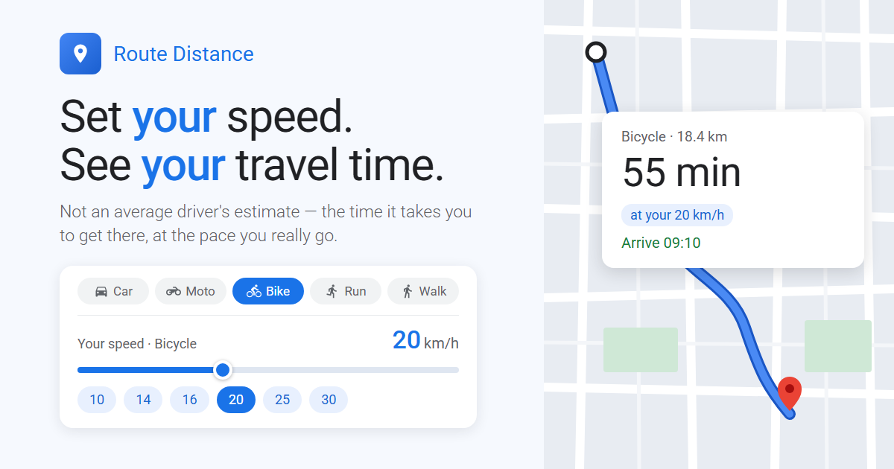

# Route Distance

**Distance, travel time & required speed — for a route you actually plan to take, at the speed you actually go.**

[](https://dan13.me/route-distance/)

🔗 **Live app:** [dan13.me/route-distance](https://dan13.me/route-distance/)

---

## Why this project exists

Navigation apps are great at one question: *"How long will this take **for an average driver** right now?"*
They are surprisingly bad at the questions people ask when they plan their own trips:

- **"How long will it take me at _my_ pace?"** A cyclist who averages 25 km/h, a runner at 5:00 min/km or a
  motorcyclist on a relaxed ride doesn't match the app's built-in assumptions.
- **"How fast do I have to go to make it on time?"** If you have 40 minutes to get somewhere, what average
  speed — or running pace — does that require, and is it even realistic?
- **"How far is this route, really?"** Road or path distance with several stops, not a straight line.

Route Distance answers exactly these, in one screen, with no account, no ads and no tracking of your routes.
It is a small, focused tool: plan a route, pick how you travel, and see the numbers you care about.

## Features

- **Route distance** between two or more places, including **multiple stops** and **alternative routes**.
- **Two ways to calculate**
  - *Travel time* — set your own average speed and get the duration and arrival time.
  - *Target time* — enter how many minutes you have and get the **required speed** (or pace), with a warning when
    it's unrealistic for the chosen mode.
- **Five modes:** car, motorcycle, bicycle, running and walking — each routed on a suitable network
  (roads, bike routes or footpaths) with sensible speed presets.
- **Running & walking pace** in min/km or min/mi.
- **Turn-by-turn route details** for every suggested route.
- **Search or click the map** to set places, use your current location, or reverse start and destination.
- **Saved places** — Home, Work and your own named locations, stored only in your browser.
- **Places on the map** — restaurants, cafés, shops, fuel, pharmacies and more, with details on click.
- **Shareable links** — the whole route (stops, mode, speed, target time) lives in the URL; one click copies it.
- **Metric & imperial units**, **street & satellite** map views, **light / dark / system** theme.
- **Installable** as a PWA, works on desktop and mobile.

## Privacy

Everything stays on your device. Saved places, settings and speeds live in `localStorage`; there are no accounts
and the app has no backend of its own. Points you search for or pick are sent only to the map, search and routing
services listed below, and only when needed.

Optional analytics (Microsoft Clarity / Google Analytics) are loaded **only** if their IDs are provided at build
time. Google Analytics never receives the URL hash, which is where the route is stored.

## Tech stack

| Area | Used |
| --- | --- |
| UI | [React 19](https://react.dev) + TypeScript |
| Build | [Vite](https://vite.dev) |
| Map | [Leaflet](https://leafletjs.com) |
| Routing | [FOSSGIS OSRM](https://routing.openstreetmap.de) (car / bike / foot profiles) |
| Address search & reverse geocoding | [Photon by komoot](https://photon.komoot.io) |
| Places on the map | [OpenFreeMap](https://openfreemap.org) vector tiles (`@mapbox/vector-tile` + `pbf`) |
| Place details | [Nominatim](https://nominatim.org) |
| Map imagery | Google tiles, or OpenStreetMap + Esri satellite |

All of these are free, keyless public services — no API keys are needed to run the app.

## Getting started

Requirements: a recent [Node.js](https://nodejs.org) (LTS) and npm.

```bash
npm install
npm run dev       # start the dev server
npm run build     # type-check and build into dist/
npm run preview   # serve the production build locally
```

## Credits

Map data © [OpenStreetMap contributors](https://www.openstreetmap.org/copyright). Routing by FOSSGIS OSRM,
search by Photon (komoot), places by OpenFreeMap / OpenMapTiles, place details by Nominatim, satellite imagery
© Esri, Maxar, Earthstar Geographics. Huge thanks to everyone running these open services.

## Support

If Route Distance is useful to you, you can
[buy me a coffee ☕](https://buymeacoffee.com/danrotaru).

---

Made by [Dan Rotaru](https://dan13.me/).
